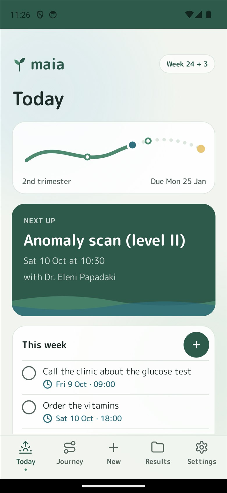
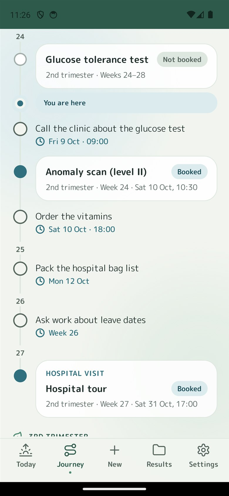
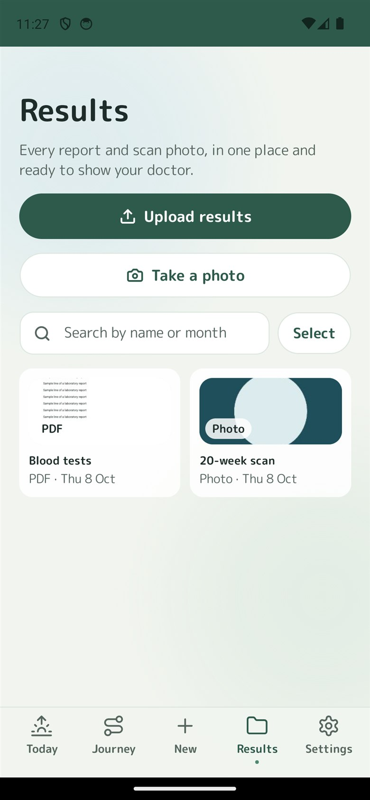
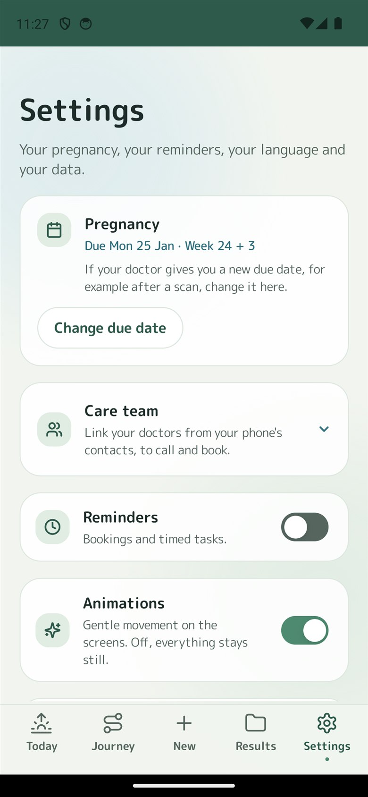

# Maia

[](https://github.com/MichaelGeranis/maia/actions/workflows/ci.yml)
[](LICENSE)

**Organise your pregnancy.** Maia proposes the checks a pregnancy usually needs, keeps them booked and
reminds her of them, and keeps every result together in one place. Android first (iOS later), built with .NET MAUI,
in English and Greek.

| Today | Journey | Results | Settings |
|---|---|---|---|
|  |  |  |  |

> [!IMPORTANT]
> **Maia is an organiser, not a medical device, and gives no medical advice.** It does not interpret results and
> does not replace a midwife, doctor or any care professional: Maia organises; her doctor decides. The Greek plan
> template is a **draft that has not been clinically reviewed**, so Release builds will not start a new journey from
> it. See [ADR 0008](docs/adr/0008-intended-purpose-and-privacy-role.md).

## Why it is built this way

- **Private by design.** Everything is encrypted on the phone with AES-256-GCM, with the key in the platform
  keystore. No account, no server, no internet permission, no analytics.
- **Clinical content is data with a review gate.** The checks and their timing live in versioned JSON per country,
  with the reviewer recorded, and store builds refuse unreviewed templates.
- **Fully tested.** The domain, application, infrastructure and presentation layers are held at 100% line and
  branch coverage in CI, and every UI string exists in both languages.
- **Decisions are written down** as [architecture decision records](docs/adr/).

## Status

The free v1 app is feature-complete on Android, in English and Greek, on a bottom bar of five slots (Today ·
Journey · New · Results · Settings): setup, Today, Journey with bookings and her dated tasks, New, Results (one
list; files, camera, sharing in and out, an in-app viewer), Care team in Settings (her OB-GYN and other doctors),
reminders on the phone, Questions, the Timer (breathing and exercises) and Settings (reminders, backup, app lock, delete, diagnostics, About).
Calendar sync was removed on 4 October 2026 (ADR 0009). Build-order item 42 gave the app one look and one set of
words ([`docs/design/README.md`](docs/design/README.md)), with screenshots captured from the app, awaiting design
sign-off. CI builds a Release APK and starts it on an emulator; `release.yml` signs an AAB and an APK from a tag.
Before a store release: the Greek plan template is a **draft** and must be clinically reviewed, the owner and a
lawyer must settle the items in [`docs/compliance.md`](docs/compliance.md), and the app must be checked on real
phones. iOS comes later.

## Repository layout

```
src/
  Maia.Domain/          Pure domain model: dating, plan templates, the plan aggregate. No I/O, no clock.
  Maia.Application/     Use cases (PlanService, PlanQueries), ports, reminder rules, problem-log format.
  Maia.Infrastructure/  Adapters: AES-GCM encryption, the data key, encrypted plan, result and draft storage, the backup format, photo metadata, template content.
    Templates/Content/  Plan templates as JSON, one per country (gr.json), English + Greek.
  Maia.Presentation/    View models, screen policies, formatting and UI text (English + Greek). No MAUI dependency:
                        unit-tested.
  Maia.App/             .NET MAUI app: XAML, platform adapters (keystore, contacts, camera, share target,
                        viewer, notifications, screen lock), composition root.
tests/
  Maia.Testing/         Shared fakes that behave like the phone (clock, plan repository, result files, backup format,
                        reminders) and test data.
  Maia.*.Tests/         xUnit tests per layer.
docs/
  product.md            Product brief: scope, positioning rules, decisions, build order.
  design/               Design system, screen specs and reference screenshots (match these).
  architecture.md       How the pieces fit: start-up, security model, persistence, reminders, CI.
  adr/                  Architecture decision records.
  compliance.md         DRAFT for legal review: intended purpose (EU MDR), GDPR, store declarations, listing.
  releasing.md          Signing, the one-time key switch and the steps for each release.
scripts/
  build-release.ps1     Signed Release APK for your own phone (optionally the personal draft-template build).
  maui-workload.sh      Installs the pinned MAUI workload set and checks it matches Microsoft.Maui.Controls (CI).
  smoke-android.sh      Installs an APK on an emulator and fails on a crash (used by CI).
licenses/               Licence texts of the fonts and packages Maia ships (shown under About Maia, Licences).
.github/workflows/      ci.yml (tests, Release APK, emulator smoke, trim analysis) and release.yml (signed builds).
```

Dependencies point inwards only: `Infrastructure → Application → Domain`, and `Presentation → Application`.
The MAUI app references Presentation and Infrastructure and provides the platform adapters.

## Getting started

Requirements: the .NET 10 SDK, 10.0.400 or a later 10.0.4xx patch (`global.json`), and for the app the MAUI workload
set the repository pins.

The everyday commands (tests, builds, the emulator, running the app, signed release APKs) are in the `Makefile`: run
`make` to list them. It needs GNU make (`winget install ezwinports.make`) and works from PowerShell, cmd or Git Bash.

```bash
# Core libraries and all tests (any OS)
dotnet test tests/Maia.Domain.Tests
dotnet test tests/Maia.Application.Tests
dotnet test tests/Maia.Infrastructure.Tests
dotnet test tests/Maia.Presentation.Tests

# The app, with the pinned MAUI workload set (MaiaMauiWorkloadSet in Directory.Packages.props)
bash scripts/maui-workload.sh install      # dotnet workload install maui-android --version <that set>
bash scripts/maui-workload.sh check        # the installed set and Microsoft.Maui.Controls match
dotnet build src/Maia.App -f net10.0-android
dotnet build src/Maia.App -f net10.0-windows10.0.19041.0   # Windows only (also needs maui-windows), for a quick UI check
```

**The MAUI workload is pinned.** `Directory.Packages.props` names the workload set (`MaiaMauiWorkloadSet`, today
10.0.400.1, which brings MAUI 10.0.20) right next to `Microsoft.Maui.Controls`. CI and `release.yml` install exactly
that set instead of whatever is newest that day, so a signed build of a commit uses the same MAUI, Android bindings and
toolchain whenever it runs, and both fail at `scripts/maui-workload.sh check` when the installed set or the MAUI
version it brings differs from `Microsoft.Maui.Controls`. To move MAUI forward, pick a newer set for the SDK band
(`dotnet workload search version`), then change `MaiaMauiWorkloadSet` and `Microsoft.Maui.Controls` together; a set
from another band (10.0.5xx, say) needs the `global.json` SDK moved too. A Dependabot pull request that bumps only
`Microsoft.Maui.Controls` fails that check on purpose. The set is not pinned in `global.json` (`sdk.workloadVersion`):
the SDK then refuses every build, the core libraries and tests included, on a machine without exactly that set.

iOS builds need a Mac (or a paired Mac from Windows). Open `Maia.slnx` in Visual Studio or VS Code with the
C# Dev Kit and .NET MAUI extensions to run the app on an emulator or device.

To put a Release build on an Android phone, run `./scripts/build-release.ps1` (add `-Install` to install it over
the app on a connected phone). It signs the APK with your own keystore (default `%USERPROFILE%\keys\maia.keystore`,
never in the repo), sets the version code from the commit count and checks the signature. Always sign with the
same keystore: Android only updates an app signed with the same key, and uninstalling Maia deletes her plan.

Until `gr.json` is clinically reviewed, a Release build cannot start a new plan: setup step 2 says so and offers
"Restore a backup". For your own phone only, `./scripts/build-release.ps1 -AllowDraftTemplates` builds a personal
APK that can use the draft template. Never share that APK. In every configuration but Debug the build refuses the
switch for an AAB, on CI and for iOS and Windows (error `MAIA0001`), so store builds only ever carry reviewed
templates.

### Signed releases from CI

`.github/workflows/release.yml` runs on a `v*` tag, or by hand from the Actions tab. It publishes a signed `.aab`
for Google Play (with the R8 mapping file) and a signed arm64 `.apk`, sets the version code from the commit count
and the version name from the tag (`v1.2.3` gives 1.2.3; a run by hand keeps `ApplicationDisplayVersion`), and
attaches them to the run as artifacts. It needs these repository secrets (Settings > Secrets and variables >
Actions):

| Secret | Value |
| --- | --- |
| `ANDROID_KEYSTORE_BASE64` | Your `maia.keystore`, base64-encoded |
| `MAIA_KEY_PASS` | The keystore password (the store and the key share it, as with `build-release.ps1`) |
| `MAIA_KEY_ALIAS` | The key alias. Optional, defaults to `maia` |

Set them from PowerShell with the GitHub CLI, so the encoded key never lands in a file or on a command line:

```powershell
[Convert]::ToBase64String([IO.File]::ReadAllBytes("$env:USERPROFILE\keys\maia.keystore")) | gh secret set ANDROID_KEYSTORE_BASE64
gh secret set MAIA_KEY_PASS    # asks for the value
```

Keep an offline copy of the keystore: without it no update can ever be signed. Store builds keep the draft gate, so
an AAB from this workflow cannot start a new plan until `gr.json` is reviewed and marked `ClinicallyReviewed`.
Play App Signing, the one-time switch away from a debug-signed build and the release steps are in
[`docs/releasing.md`](docs/releasing.md).

The build treats warnings as errors and runs the .NET analyzers in *Recommended* mode. Package versions are
managed centrally in `Directory.Packages.props`.

## Key design points

- **Local-first and encrypted.** The plan and every result file are encrypted with AES-256-GCM before they touch
  disk. The key lives in the platform keystore and is never replaced over her files; nothing goes to cloud backup or a
  new phone except her own encrypted backup file. The free app has no internet permission and needs no backend. See
  [ADR 0002](docs/adr/0002-local-first-encrypted-storage.md) and [ADR 0005](docs/adr/0005-encrypted-backup-file.md).
- **Plan templates are data, with a clinical gate.** Checks, windows and wording live in versioned JSON per
  country, with the reviewer and date recorded. Release builds refuse templates not marked `ClinicallyReviewed`.
  See [ADR 0003](docs/adr/0003-plan-templates-as-reviewed-data.md).
- **English and Greek from v1.** Clinical text is stored per language with English as the fallback.
- **The domain decides status; the UI renders it.** Whether a check shows as *book now*, *booked*, *how did it go?*
  or *probably done* is derived from the plan and today's date, never stored, so it cannot go stale.
- **Reminders from Maia only.** Maia writes nothing to the phone's calendar. Its own notifications remind her of
  bookings and timed tasks 24 hours and/or 2 hours before, as she chooses, and when it's time to book; a booking made
  less than a day ahead still rings, 2 hours before. They are set again from the plan after every change. See
  [ADR 0009](docs/adr/0009-no-calendar-sync-reminders-on-the-phone-only.md) (which supersedes ADR 0004) and
  [ADR 0006](docs/adr/0006-reminders-on-this-phone.md).
- **A problem log without health data.** See [ADR 0007](docs/adr/0007-diagnostics-without-health-data.md).
- **An organiser, not a medical device.** See [ADR 0008](docs/adr/0008-intended-purpose-and-privacy-role.md) and
  [`docs/compliance.md`](docs/compliance.md).

## Android permissions

`POST_NOTIFICATIONS` and `RECEIVE_BOOT_COMPLETED` (reminders on this phone), `USE_BIOMETRIC` (the optional app
lock), `VIBRATE` (Breathing's gentle vibration). No internet, calendar, camera, contacts or storage permission: the camera
app, the contact picker and the document picker hand over only what she picks. Maia appears in the share sheet for PDFs
and images and in "Open with" for PDFs. Details: [`docs/architecture.md`](docs/architecture.md), Security model.

## Adding or changing a plan template

1. Edit or add `src/Maia.Infrastructure/Templates/Content/<country>.json`. Every check needs `en` and `el` text.
2. Bump `version` with every content change: plans remember the version they were created from, and existing plans
   take the newer version at start-up (checks it adds join switched off; see ADR 0003).
3. Keep `reviewStatus: "Draft"` until a licensed clinician signs off. Then set `ClinicallyReviewed` together with
   `reviewedBy` (the clinician's name and role) and `reviewedOn` (`yyyy-MM-dd`); the catalog rejects one without the
   other.
4. `dotnet test` validates every shipped template.

## Changing the stored plan format

Stored plans are versioned (`PlanDocument.CurrentSchemaVersion`). Never rename or remove a stored field without
bumping the version and adding a step to `PlanDocumentMigrator`, with a test using a real sample of the old format.

## Contributing

Contributions are welcome, especially reviews of the plan templates by clinicians, and new countries. Read
[CONTRIBUTING.md](CONTRIBUTING.md) first. This project follows a [Code of Conduct](CODE_OF_CONDUCT.md). To report a
security problem, see [SECURITY.md](SECURITY.md); please do not open a public issue.

## License

The code, documentation and plan templates are licensed under the [Apache License 2.0](LICENSE). The bundled fonts,
icons and libraries keep their own licences: see [THIRD-PARTY-NOTICES.md](THIRD-PARTY-NOTICES.md). The licence does
not grant rights to the Maia name or logo (Apache 2.0, section 6).
