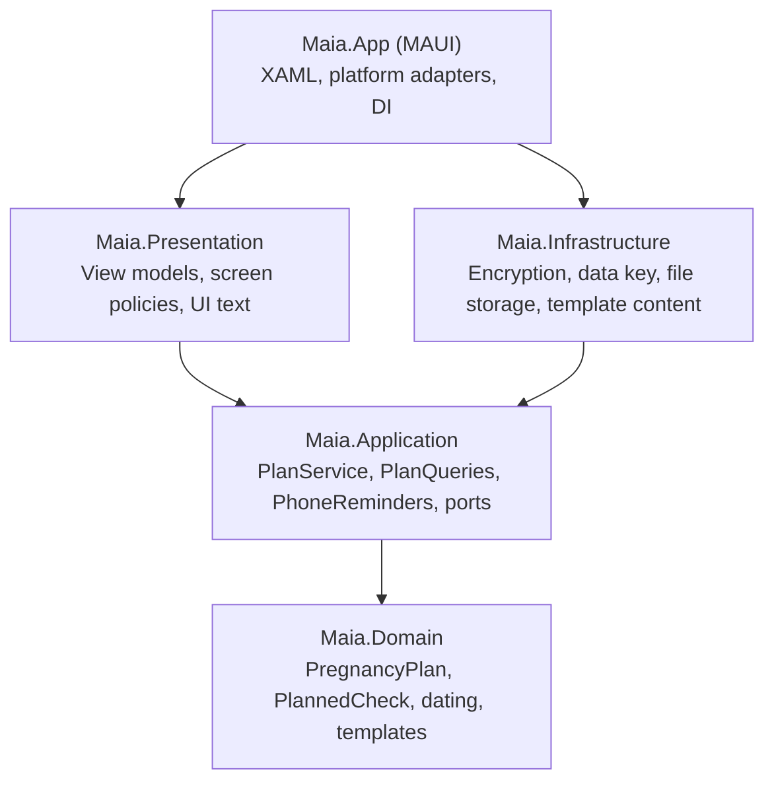

# Architecture

How the pieces fit. Product rules are in [`product.md`](product.md), decisions and their reasons in [`adr/`](adr/),
store and privacy matters in [`compliance.md`](compliance.md), and signing and shipping in
[`releasing.md`](releasing.md).

## Layers



| Layer | Owns | Must not |
| --- | --- | --- |
| Domain | Rules: dating, check lifecycle, status, care team, tasks, questions, blood pressure readings, template updates | Do I/O, read the clock, know about JSON or MAUI |
| Application | Use cases, ports (interfaces), reminder rules, the problem-log format | Reference platform APIs or storage formats |
| Infrastructure | Encryption, the data key, file formats, template content, photo metadata | Contain business rules |
| Presentation | View models, screen policies (start-up flow, screen loader, day watch, navigation gate), formatting, strings | Reference MAUI |
| App (MAUI) | XAML, platform adapters (keystore, contacts, camera, share target, viewer, notifications, screen lock), DI | Change the plan except through `PlanService`; hold screen logic |

## The plan aggregate

`PregnancyPlan` is the single aggregate in v1 (ADR 0001). Every change goes through its methods, called from
`PlanService`, so its rules and events live in one place.

- **Dating.** `PregnancyDating` holds the due date; everything week-based derives from it. Changing the due date
  (Settings, `ChangeDueDate`) moves every window; bookings stay on their days.
- **Checks.** Each `PlannedCheck` has a *persisted* `CheckState` (Pending, Booked, Done, NotNeeded) and a *derived*
  `CheckStatus` for a given day: `StatusAt(age, today, policy)` gives Later, BookNow, Booked, AwaitingUpdate ("How did
  it go?": booked for a day already past), Done, ProbablyDone, NotNeeded or Milestone. Status is never stored. Entries
  she added (on Add) are never "probably done".
- **Entries she adds.** `PregnancyPlan.AddEntry(name, kind, EntryWhen, today)`: an `EntryKind` (DoctorVisit, Exam,
  HospitalVisit, Other; `PlannedCheck.Kind` is null for template checks, which keep their `CheckCategory`) and an
  `EntryWhen` (Booked with an appointment, Done on a day, or NotBookedYet). Booked raises `CheckBooked`, done
  `CheckCompleted`. They keep Origin AddedByParent and Category IfAdvised. Names are at most
  `PlannedCheck.MaxTitleLength` (200) per language (`entry.title.too_long`; the Add screen types at most 150).
  `AddCheck` and the suggestions on Add make Exam entries.
- **An entry stands at its day.** One she added stands in the week of its booking when booked, and of the day it was
  done when done (`PregnancyPlan.WindowOn`, capped at week 52); `Book`, `MarkDone` and `ChangeDueDate` move it there.
  `CancelBooking(id, today)` and `Reinstate(id, today)` put it back to waiting for a date, from today's week for
  `UnbookedWindowWeeks` (2), so it reads "Book now" and gets no "time to book" reminder for its old week; `Reopen(id,
  today)` returns it to its booking's week, or today's week with none. Booked and done days are not checked against
  today in the domain (Add limits its pickers). Checks from her country's plan keep their template weeks.
- **Lifecycle.** A done check can't be marked not needed; it is reopened first (`Reopen`, "Not done yet"). Marking a
  check done before its booked day drops the unused booking. `CancelBooking` and `Reinstate` complete the set.
  Operations that would change nothing (saving the same booking again, marking a done check done) raise no event and
  leave the revision as it is.
- **Results.** `ResultAttachment` holds metadata only. File content lives in encrypted blob storage; the plan keeps
  the blob id. Results stand apart from the checks and entries (`PregnancyPlan.Results`; no check holds any since
  stored format 6): `AttachResult`, `RenameResult`, `RemoveResult(AttachmentId)` and `FindResult`.
- **Templates.** The plan remembers the template id and version it came from. `UpdateFromTemplate` takes everything a
  newer version holds: wording, weeks and categories, and the checks it adds, switched off (ADR 0003).
- **Home time zone.** `TimeZoneId` (an IANA id) is the zone every booking and task time is a wall-clock time in.
- **Events.** State changes raise domain events (`CheckBooked`, `CheckBookingCleared`, `CheckCompleted`,
  `ResultRemoved`, `TaskScheduled`, `TaskUnscheduled`,
  `DueDateChanged`, `PlanLanguageChanged`, `CareTeamChanged`, `PlanTemplateUpdated`). `PlanService` dispatches them
  after a successful save. There is no "next visit" any more: her next visit is her next booked entry.
- **Care team.** `CareRole` has the OB-GYN, the roles once shown as "coming next" (kept, unused) and seven doctors
  she can link on Care team (Dentist to Gastroenterologist). Only the OB-GYN is used for bookings.
- **Safety nets.** Domain lists are read-only wrappers. `DomainException` carries a stable code; its message names no
  check, date or week, so nothing from the plan can leak through an error.

## Command flow

```mermaid
sequenceDiagram
    participant UI as View model
    participant S as PlanService
    participant R as IPlanRepository
    participant P as PregnancyPlan
    participant N as PhoneReminders
    UI->>S: BookCheckAsync(ogtt, 12 Oct 08:30)
    S->>R: LoadAsync
    S->>P: Book(...)
    P-->>P: raise CheckBooked
    S->>R: SaveAsync (encrypted, durable, atomic)
    S-->>UI: done (does not wait for the reminders)
    S--)N: RearmAsync, in the background
    N-->>N: a failure is reported by code; the next change or start tries again
```

Commands are serialized through one gate per `PlanService` instance (register it as a singleton). The phone's
reminders follow in the background, and a removed result's file is deleted after the save. Maia writes nothing to the
phone's calendar (ADR 0009). A command that leaves the plan as it was (every change moves
`Revision`) saves nothing and sets nothing again, and changes reminders never read (results, questions, blood pressure readings, the care team)
do not set them again unless the plan took its home time zone in the same save.

`PlanQueries` reads, each screen from one load: `GetWeekAsync` (`WeekOverview`, whose `NextUp` is her next booked
entry or her next task with a date and time, from today on), `GetTimelineAsync` (Journey, with `DatedTasks`),
`GetSnapshotAsync` (Add: timeline, care team, the checks she can add back), `GetResultsOverviewAsync` (Results: every
result newest first) and
`GetCareContactsAsync` (Care team: every linked contact).

`PlanService` commands for the change request's screens: `AddEntryAsync(name, kind, when)` and
`ReinstateAsync(CheckId, EntryWhen)` (a switched-off check brought back from Add, then booked or done, in one save);
`AttachFileAsync` (lab links are gone since item 33), `RenameResultAsync` and
`RemoveResultAsync(AttachmentId)`. After your
visit's `RecordVisitAsync` and `VisitUpdate` are gone.

## Start-up

- `App` constructor: applies her saved language (English on a phone in a language other than English or Greek, when
  she hasn't chosen), keeps MAUI's share copies in the internal cache and empties the whole cache.
- `MauiProgram`: registers the global problem handlers (`CrashReporting`) and, only when her encrypted files exist,
  starts reading the data key in the background, because the keystore's first read is often the slowest step of a cold
  start. A key is never made there.
- `App.CreateWindow`: `StartupFlow.OpensOnWeek` picks the first screen. With a plan file on the phone, no share
  waiting, no language switch under way and Maia not starting locked, the shell opens straight on Today, and its
  load is the only plan load before it shows. Otherwise the start-up screen (`StartupViewModel`) opens the plan.
  Reminders on this phone are set again in full on every start.
- After the first screen has loaded, either way: the plan follows the app's language (`PlanLanguageSync`, which
  renames her checks and so her reminders); `PlanUpkeep` gives a plan without a home time zone the phone's, takes a
  newer template (with a calm toast) and clears setup's draft; and result files the plan no longer points at are swept
  (older than an hour, only after a clean load, never when the plan came from `plan.maia.bak`). Today loads again only
  if her plan now reads differently.
- If the first Today load fails, the start-up screen takes over once, with no toast. `StartupViewModel.OpenAsync`
  joins an opening that is still running instead of starting a second one.
- Start-up screen states: Opening (a spinner), CannotOpen (`key.unavailable` or `plan.damaged`: Restore a backup, Start
  again, Try again), NeedsUpdate (`plan.newer_app`: nothing that could change the plan) and OpenFailed (any other
  error: Try again only). Restore and Start again are offered, and run, only in CannotOpen.
- On every `Window.Activated`: a file handed to another app is removed from the cache, and a plain "Maia reminder"
  left in the shade is cleared. `AppLockPresenter` follows the same window.

## Screens

- Page events go through `ScreenWork` in Maia.App, never `async void`. It only wires `Appearing`, `Disappearing`,
  `Window.Resumed` and `Stopped`. The policies live in `Maia.Presentation.Common` and are unit-tested:
  - `ScreenLoader`: a failed load is reported (operation code and exception type) and shown as a calm line; a
    `PlanUnreadableException` hands over to the start-up screen (`INavigator.GoToStartupAsync`).
  - `LiveScreen` with `DayWatch` and `IWakeTimer`: Today and Journey load again when they appear, on every resume,
    and just after local midnight while they show. A screen whose last load failed tries again when the wait ends.
  - A view model that decides whether a screen keeps its scroll position gets Shell's navigation events from its page:
    Journey's page passes `NavigatedFrom`'s destination (on a Push) to `PlanViewModel.Leave` and `NavigatedTo`'s
    previous page to `PlanViewModel.Arrive`, because Shell reports the return from a pushed page as PopToRoot, not
    Pop. Straight back from the screen opened over it, Journey keeps her place; any other way in, it opens at today
    (`PlanFocus`, the entry Add has just saved, wins).
  - Settings is a tab, so its page lives across tab switches: `SettingsViewModel.Leave()` (on `Disappearing`) closes
    what leaving the pushed page used to close: the backup form and its passwords, an unanswered "did you keep it?",
    the delete confirmation and a due-date edit.
  - `ScreenLoad.ReloadAsync`: the reload after an action keeps her change and says calmly when the list can't be shown.
  - `ErrorMessages`: each known error code has its own words in English and Greek; a test holds every code in the
    source to words or to an explicit internal list.
- `NavigationGate` sits inside `ShellNavigator`: one navigation at a time; a tap while one is on its way is dropped; a
  screen's own navigation waits its turn (up to 5 s); going where she already is does nothing; a failure is reported
  as `nav.<route>`. A guard test fails if any App file calls `Shell.Current.GoToAsync` outside `ShellNavigator`.
- **Bottom bar.** Maia draws its own five-slot bar (`Controls/BottomBar`) on every main page through the `MaiaPage`
  template; Shell's own tab bar is hidden. The Shell `TabBar` (route `main`) holds five tabs, `week`, `plan`
  (Journey keeps its first route name), `add`, `results` and `settings`, which is the most Android's
  BottomNavigationView takes: another Shell tab would bring in a hidden "More". Add is a tab like the others (build
  order item 29), so its page stays and starts afresh after each save; the care team, once the `team` tab, is a card
  in Settings (`SettingsViewModel.Team`, the same `TeamViewModel`). `TabLabelFit`
  (Presentation) works out the one size the five names share from their measured widths and her text scale: 12,
  shrinking together so neighbours keep 4 dp apart, not below what looks like 9 (where 2 dp may be left), and below
  that only rather than touch.
- `CommandTap` binds taps to the control's own `Command`, so `CanExecute` and the async commands' no-re-entry guard
  hold; a control that can't run is dimmed to 50 %. A guard test fails on a direct `Command?.Execute(`.
- Lists update by difference (`CollectionSync`) and keep their row instances, so only new rows pop. Heavy row detail
  (the expanded check card, the task and question editors) is built only while it is open (`LazyView`).
- **Today builds a bounded number of rows** (build-order item 26). Its task card is a `BindableLayout`, which
  builds every row it is given as real Android views, all at once, on the UI thread. A load test (Release build, x64
  emulator) measured about 12 ms and about 70 JNI global references per task row: 500 open tasks froze the UI thread
  for 3.9 s and cold start took about 7 s, and above about 640 open tasks .NET for Android reached its ceiling of
  46,080 global references and hung in a GC loop ("isn't responding"). Today is the first screen and a restored backup
  is not capped (`PregnancyPlan.Rehydrate`), so a big plan stopped Maia from ever starting. `WeekViewModel` therefore
  shows this week's tasks only, at most `CollapsedRows` (5) or after "Show all" `ExpandedRows` (20), plus one
  "All tasks" line (item 38; once five lines per group), whatever the plan holds; a test with 900 tasks
  holds it to that. The whole list lives on All tasks (`TasksViewModel`), a virtualised `CollectionView` that builds
  only the rows on screen and gets its first load as one new collection rather than a change per row. Both screens
  share the row (`TaskItem`, `Controls/TaskRowView`) and its behaviour (`TaskRows`: tick, one editor at a time, save,
  delete, reload), so there is one source of truth for a task row. Any new list that can grow with her data must be
  virtualised or bounded the same way. Results is one: a `CollectionView` with a two-column `GridItemsLayout` and
  everything above the tiles as its header, so a pregnancy's worth of results builds only the tiles on screen; a
  tile's removal question is built only while it asks (`LazyView`).
- Today shows calm blank cards until its first load completes (`WeekViewModel.IsLoaded`), so a plan still being
  read never shows as "Nothing booked yet". `Motions.Rise` on a layout hidden at first plays when it first shows.
- Toasts come in two kinds (`INotifier`): `Show` confirms what she did (pine, with a tick); `ShowNotice` says calmly
  that something did not happen, a refusal or a failure (Sand, no tick). A guard test keeps errors off `Show`.
- Plan screen loads that overlap merge: a call made while one runs waits for it, and one more pass follows.
- View models bound to two-way pickers start from values the picker can show, and never count the picker's own
  write-backs (at bind, or when a minimum or maximum moves) as her choice.
- Transient view models must not implement `IDisposable`: MAUI's DI scope would keep every one until Maia ends.
  Pages release resources in `OnDisappearing` (the result viewer calls `Close()`).

### Where things live

- **Presentation**, one folder per area: `About/` (About, privacy notice, terms of use, licences; ports `IAppVersion`,
  `ILicenceTexts`), `Privacy/` (`AppLock`, `LockViewModel`; ports `IScreenLock`, `IAppLockPreference`), `Settings/`
  (`SettingsViewModel` with `DueDateSettings`, `AppLockSettings`, `PhoneRemindersSetting` (the Reminders card),
  `ReminderPreferences` with its port `IPreferenceValues`, `DiagnosticsViewModel`, `IBackupHistory`,
  `INotificationAccess`), `Setup/` (`SetupSession`, which keeps setup's choices in the encrypted
  draft and resumes at start-up, and `DueDateEntry`, shared with Settings), `Startup/` (`StartupFlow`,
  `StartupViewModel`, `PlanUpkeep`), `Results/` (filing, `PhotoPolicy`, `ShareIntake`, the viewer), `Common/` (screen
  policies), `Navigation/` (`INavigator`, `NavigationGate`, `PlanFocus`, `TasksFocus`, `TabLabelFit`, `IChooser`),
  `Localization/` (`Text`, `Text.Culture`, `PlanLanguageSync`), `Accessibility/` (`ControlRole`, `ScreenReaderText`),
  `Add/` (`AddEntryViewModel`, the New tab), `Plan/` (Journey, with `IJourneySettings`), `Calm/`
  (the Timer, `BreatheViewModel` with `Rhythm`, `BreathTones` and its ports), `Week/` (Today, and All tasks with `TasksViewModel` and the shared
  `TaskItem` and `TaskRows`), `Care/` and `Questions/`.
- Other ports the app implements: `IDialer` (with `ChooseAsync` for several OB-GYNs), `IChooser` (the phone's own list
  of choices, used to tag a result), `IContactPicker` (with `TakeInterruptedPickAsync` for a pick Android
  interrupted), `IResultPicker`, `IResultViewer`, `IResultRenderer`, `IPhotoProcessor`, `IScreenAwake` (Breathing keeps
  the screen on), `IAnnouncer` (screen-reader announcements), `IBreathVibration` and `IBreathSound` (Breathing's cues;
  Android adapters in `Platforms/Android/BreathCues.cs`, nothing elsewhere, so the switches hide), `IBreatheSettings`
  and `IJourneySettings` (her Timer switches and times, and Journey's "Tasks" switch, kept in Preferences as
  `breathe.vibration`, `breathe.sound`, `timer.breathing.*` (the one Timer's times, under the key of the mode it used to be; `timer.mode` and `timer.exercise.*` from item 46 are no longer read) and `journey.show_tasks`: settings, not health data, not in the backup and not
  cleared by Delete everything), `IBackupFiles`, `ILanguageSwitcher`, `INotifier`.
- **App**: `Services/` holds the adapters (`AppLockPresenter`, `SecureStorageSecretStore`, `PhoneReminderServices`
  (`MauiPreferenceValues`, `MauiNotificationAccess`), `CacheFolders`, `DiagnosticsFile`, `LoggerErrorReporter`,
  `CrashReporting`, `ShellNavigator`, `AboutServices` with the licence texts bundled from `licenses/`,
  `PreferencesBackupHistory`, `ChoiceSheet`, `BreatheServices`, `PreferencesJourneySettings`, …);
  `Platforms/Android/` holds `LockWindow`, `ScreenLock` (`AndroidScreenLock`, `ScreenPrivacy`), `AndroidReminders`,
  `ShareActivity`, `CameraCapture`, `DocumentPicker`, `AndroidPhotoProcessor`, `AndroidResultRenderer` and
  `BreathCues`; `Controls/` holds `ScreenWork`,
  `CommandTap`, `LazyView`, `ZoomView`, `BottomBar`, `LightBorder` and the drawn controls.

## Security model

- AES-256-GCM with a random 96-bit nonce per write. Envelope: `MAIA` · version · nonce · tag · ciphertext.
- Each ciphertext is bound to its slot through associated data (`plan`, `blob:<id>`, the draft's name), so files cannot be swapped.
- **The data key.** 32 bytes, kept in the platform keystore (MAUI `SecureStorage`) as `maia.data-key.v1` and cached in
  memory once read. `DataKeyProvider` (Infrastructure) holds the rules; `SecureStorageSecretStore` (App) is a thin
  adapter. A key is made only while none of her encrypted files (plan or result) exists, and is read back after it is
  written, because Android's SecureStorage can drop a write silently. If her files exist and the key is missing,
  malformed or unreadable, or the keystore throws, the load fails as `key.unavailable` and every file is left
  untouched: Maia never makes a new key over her files. The start-up screen then offers Restore a backup or Start again.
- **No copies off the phone.** `android:allowBackup="false"` (Android 11 and older) and `dataExtractionRules`
  (Android 12+, `Platforms/Android/Resources/xml/data_extraction_rules.xml`) exclude every domain from cloud backup and
  device-to-device transfer. Files copied without their key could never be opened; moving phones goes through her
  encrypted backup file (ADR 0005).
- **Delete everything** (and Start again) removes every result file, every `plan.maia*` file (main, `.bak` and
  interrupted `.tmp`), the problem log, the reminders and, last, the data key. Her next plan gets a new key, and
  leftover encrypted files (the setup draft, an earlier build's calendar link file) can no longer be opened.
  `CreatePlanAsync` and `RestoreBackupAsync` also remove leftovers and start with a new key.
- **No network.** The Android manifest has no `INTERNET` or `ACCESS_NETWORK_STATE` (Debug builds get `INTERNET` from
  the SDK for the debugger). Nothing in the app uses the network. Add both back only with the paid cloud backup.
- **Permissions** (Android): `POST_NOTIFICATIONS` (asked only when she turns reminders on, in Settings' Reminders card
  or with "Reminders on this phone" at setup step 3), `RECEIVE_BOOT_COMPLETED` (sets reminders again after a restart),
  `USE_BIOMETRIC` (install-time, used only by the optional app lock) and `VIBRATE` (install-time, used only by
  Breathing's gentle vibration). No camera, contacts or storage permission: the camera app, the contact picker and the
  document picker hand over only what she picks. Package-visibility queries: the dialer, the contact picker and the
  camera app.
- Result files are stored under random ids; names and types exist only inside the encrypted plan. Blob ids are
  validated before touching the file system (no path traversal).
- **Viewing results.** PDFs and photos open inside Maia (`ResultViewerPage`). A PDF is drawn with Android's
  `PdfRenderer` from an in-memory file (`memfd_create`) on Android 11+, or on older versions from a private file whose
  name is removed the moment it is opened, and is released when the viewer closes. A PDF the phone can't draw, or one
  over 60 pages, goes to another app only when she asks ("Open in another app"), from `cache/open` with a read grant
  for that one file, and is removed when she comes back to Maia. That app's own copies and recent-files list are
  outside Maia's control; the screen says so. A photo type the phone can't draw (HEIC on Android 7 and 8) takes the
  same path: `ResultFiling.OpenAsync` sends every file to the viewer, which says Maia can't show it here, that the
  other app may keep its own copy, and offers "Open in another app".
- **Sharing results.** She chooses results on Results and taps Share (`ResultFiling.ShareAsync`). Each file is
  decrypted into its own numbered folder under `cache/open` (two results may share a name), named with its file ending
  (`ShareFiles.FileName`), and the share sheet opens with `ACTION_SEND` or `ACTION_SEND_MULTIPLE` (`ResultSharer`),
  a read grant for just those files through the file provider, and Maia's own Share entry left out. The copies are
  removed when she comes back to Maia, as after "Open in another app"; what the receiving app keeps is its own.
- **Cache.** The whole cache, internal and external, is emptied at start-up and after Delete everything or Start
  again. `FileProvider.TemporaryLocation` is Internal. On Android the document picker is Maia's own
  `ACTION_OPEN_DOCUMENT`, and picked and shared files are read straight from their provider, so no plaintext copies
  are made. A camera photo is deleted once it is filed.
- **App lock** (Android, off by default). With "Lock Maia with your screen lock" on, Maia locks when it starts and after
  more than a minute away (measured on a clock the phone's time setting can't move), and only the phone's own prompt
  opens it (`BiometricPrompt` with the device credential on Android 11+, the Keyguard confirm screen before). Maia
  never sees the PIN, pattern or fingerprint. The lock screen is a full-screen window of its own (`LockWindow`, an
  AndroidX `ComponentDialog`), so the Shell pages underneath keep their state. Starting locked, Maia opens on the
  start-up screen behind the lock, so nothing of the plan is loaded or drawn before she unlocks. Without a screen lock
  on the phone, Maia can't lock, and Settings says why.
- **Recents.** From Android 13 Maia's recents thumbnail is never taken. Older Android can only hide it with
  `FLAG_SECURE`, which also blocks screenshots, so that is set only while the lock is on.
- Export is an encrypted backup file (ADR 0005): its key comes from a password she chooses (PBKDF2-SHA256), never from
  the device key; the file is AES-256-GCM in 64 KiB chunks, so tampering, reordering and truncation are caught.
- **Outside the encryption**, in app preferences: her language, whether reminders are on and her choices for them
  (`reminders.on`, `reminders.when`, `reminders.discreet`), whether the lock is on, her Timer switches and times, and "Show my
  tasks", two backup timestamps, and the reminder schedule (plain running numbers, times and plain words that name no
  check or task; see Reminders on this phone). None of it is health data. Preferences an earlier build wrote for
  calendar sync are left where they are (no migration); only `calendar.reminders` and `calendar.discreet_titles` are
  still read, as her reminder choices until she chooses again.
- Paid cloud backup (later) uploads the same encrypted envelopes; the server stores only ciphertext.

## Persistence

- One file, `plan/plan.maia`, written durably and atomically: a temp file flushed to disk (`DurableFile`, fsync), then
  `File.Replace` with the previous version kept as `plan.maia.bak`. The parent folder is not fsynced after the rename
  (.NET has no API for it); that residual risk is accepted.
- **Fallback.** If the main file fails to decrypt or parse, `plan.maia.bak` is loaded and the fallback is reported once
  as `plan.load.fallback`. The next save then moves the new file into place and keeps the good `.bak`, rather than
  rotating the damaged file into it. If both copies fail, the load is `plan.damaged` and the start-up screen offers a
  way on, never a crash loop.
- **Newer app.** `PlanDocumentMigrator` throws its own `NewerPlanSchemaException` for a plan saved by a newer Maia.
  That is refusal, not damage: no fallback to `.bak`, never written over, `plan.newer_app` on the start-up screen.
  Create, change and restore all refuse it.
- **Repair on load.** `PregnancyPlan.Rehydrate` checks the rules the code relies on and repairs a broken record
  safely, reporting `plan.load.repair.<code>` once for each kind: booked without an appointment becomes pending; a
  booked or done milestone is cleared; an appointment naming a contact no longer in the care team keeps its date; a
  task with a time but no date keeps the task, and so does one whose trimester or week can't stand with the rest
  (with a date, or both together) without them. Anything else the mapper rejects counts as damage.
- **Schema.** The stored shape (`PlanDocument`) is separate from the domain model and carries `schemaVersion`
  (currently 9). A current-schema plan is read straight from its bytes; older ones go through `PlanDocumentMigrator`
  step by step on raw JSON. Every step has a test with a real sample of the old format.
  - Version 4 added the optional `timeZone`, absent in older plans.
  - Version 5 (the owner's change request) adds each check's `kind` (set for entries she added; every check she added
    before becomes an Exam) and the `untaggedResults` list (empty). It places checks she added and then booked or did
    in the week of that day, as entries now stand. It turns `nextVisit` into a booked Doctor-visit entry with the
    fixed id `custom-next-visit` (`-2`, `-3` only if taken, so every read of a version-4 file gives the same id), named
    "Visit with <doctor>" / "Επίσκεψη: <doctor>" after the visit's contact or else her first OB-GYN, or "Appointment" /
    "Ραντεβού" with none, in both languages; it adds none when a booking already stood at that day and time. And it
    gives Maia's usual suggestions saved under one name both their English and Greek names (from a fixed table of
    what Maia saved, not from the resx files). The new care roles (Dentist to Gastroenterologist) arrived in the same
    release, so a build that can't read them refuses the plan as newer rather than misreading it.
  - Version 6 (the owner's fifth round) keeps results apart from her journey: every result filed under a check (each
    check's `results`), then every one in `untaggedResults`, moves into the plan's own `results`, and checks hold none.
  - Version 7 (item 33) drops lab links: every result of kind `Link` is removed and no result keeps a `link` field.
  - Version 8 (item 43) changes nothing stored: it adds what an older Maia would drop without a word, a task's
    `trimester` or `week` (a task without a date is for one of them; one saved before keeps neither) and an entry's
    trimester `AfterBirth`, so an older Maia refuses the plan as newer rather than lose them. An entry's note is its
    `description`, already stored.
  - Version 9 (item 45) adds her blood pressure readings, `bloodPressure` (each `id`, `systolic`, `diastolic`, `date`,
    `time`); a plan from before gets an empty list. An older Maia refuses the plan as newer rather than drop them.
- **Result files** are written as `<id>.tmp`, flushed, then moved to `<id>.blob`. Each picked file is checked for type
  and known size, then read whole up to the 25 MB cap and released before the next one.
- **Orphans.** `RemoveOrphanedFilesAsync` deletes stored files the plan does not point at once they are older than an
  hour; it runs once per start, in the background, after a clean load only.
- **Loading again.** Screens and the reminders each load the plan, often for one change.
  `EncryptedPlanRepository` keeps the main file's bytes as last read or written, with the `PlanDocument` they hold;
  while the file still holds exactly those bytes, a load maps a new plan from that document instead of decrypting and
  parsing again. The file is still read every time, so anything that changed it (another copy of the store, a torn
  write) is noticed. Each load gets a plan of its own to change; the fallback to `.bak` is never kept.
- **Other encrypted files.** The setup draft (`drafts/setup.maia`, `EncryptedDraftStore` behind `IDraftStore`) uses
  the same cipher and data key. A draft that can't be read counts as no draft. The calendar link file earlier builds
  kept (`calendar/calendar-links.maia`) is left where it is on a phone that has one; nothing reads it (owner
  decision, no migration).
- JSON uses source generation (trimming- and AOT-friendly).

## Reminders on this phone

ADR 0006, and ADR 0009, which supersedes ADR 0004: Maia has no calendar sync. It writes nothing to the phone's
calendar, asks for no calendar access, and her reminders are Maia's own notifications. Android only for now; iOS and
Windows get a scheduler that does nothing.

- **Her choices.** `ReminderSettings`: `When` (`ReminderPreference` DayBefore, the default, TwoHoursBefore or Both) and
  `DiscreetTitles`. She sets them in Settings' Reminders card (`PhoneRemindersSetting`: the switch, "Remind me" and
  "Discreet lock screen"), and turns reminders on at setup step 3 with "Remind me" (`SetupSession.RemindMe`; a draft
  from an earlier build reads as off). `ReminderPreferences` (Presentation, `IReminderSettingsStore` over
  `IPreferenceValues`) keeps them under `reminders.on`, `reminders.when` and `reminders.discreet`; until she chooses
  again, the calendar-sync keys `calendar.reminders` and `calendar.discreet_titles` are read instead, so her earlier
  choices hold.
- **When they ring** (`ReminderTimes`, pure). "24 hours before" rings 24 hours before a booking with a time, or the
  evening before (`ReminderSettings.EveningReminderHour`, 20:00) one with only a day, while that is still ahead; once
  it has passed, nothing rings in its place (a booking made less than a day ahead gets none).
  "2 hours before" rings 2 hours before, or the evening before for a day-only booking. "Both" rings each while it is
  still ahead. `ToCome` gives which will ring; Journey's reminder caption uses it only while reminders are on
  (`PlanService.GetActiveReminderSettingsAsync`, null while off). Reminders are known by `check:<id>` and `task:<id>`
  (`KeyFor`).
- `PhoneReminders` (Application) keeps the phone's reminders in step with the plan while they are on. Every piece of
  work sets all of them again from the latest saved plan: after each saved change that can move one (not her results,
  questions or care team), when her choices change (`SaveSettingsAsync`, `SetOnAsync`), after restore and delete, and
  on every app start. Work runs off the UI thread, one piece at a time; changes that arrive meanwhile fold into one
  next run. Turned off, or with no plan, every reminder is cancelled.
- `ReminderPlanner.For(plan, settings, now, home)` (pure): each upcoming booking of any entry and each timed task gets
  the reminders `ReminderTimes` gives (there is no "time to book" reminder since build-order item 41). At most 64 are
  set, soonest first. `MayArriveLate` (1 hour) records that
  inexact alarms can be late, so the words name the day and time ("Today at 08:30", "Tomorrow at 00:45", "At 01:30"),
  never "in 2 hours".
- `KeptReminders`: each reminder gets a plain running number (a counter that wraps at 1,000,000,000), never one worked
  out from what it is for. What is kept for after a restart, in plain preferences, is one tab-separated line per
  reminder: number, time and the escaped plain words. The first replace after Maia starts cancels every old alarm by its
  kept number and sets them all; after that `KeptReminders.Change` compares with what this run set (held in memory
  only, since the full words name checks): a reminder exactly as it was keeps its alarm and number, and only the others
  are cancelled or set under new numbers.
- `AndroidReminderScheduler`: inexact `setAndAllowWhileIdle` alarms (no exact-alarm permission), a "Reminders"
  channel, a private `ReminderReceiver` (show and dismissed actions) and `ReminderRestartReceiver` for boot and package
  replaced, which restores the kept schedule.
- **Lock screen.** Each reminder is posted with its full words as a `VISIBILITY_SECRET` notification (silent while the
  phone is locked) and, only while locked, as a `VISIBILITY_PUBLIC` plain "Maia reminder" that rings. The plain one
  goes when she swipes the full one away, when Maia's window activates, and on every replace. On a phone without a
  secure lock, a reminder that fires while it is locked posts only the plain one.
- `POST_NOTIFICATIONS` is asked only when she turns reminders on (the card's switch, or "Remind me" at setup step 3,
  through `INotificationAccess`); a refusal shows a calm Sand note.

## Results: files, photos, camera and sharing

- **Picking.** `ResultFiling` takes one file at a time: type, then known size, then a read capped at 25 MB. A file it
  can't keep doesn't stop the others; the message names each one with the reason. Read failures are reported as
  `results.read`.
- **Photos.** `PhotoPolicy` (Presentation) decides and `IPhotoProcessor` (Android) does the pixel work. A photo over
  3000 px on its long edge, or any HEIC/HEIF, becomes a JPEG: long edge 3000 px, quality 90, orientation applied, no
  metadata, name ending `.jpg`. A smaller JPEG, PNG or WebP is kept as it is, without its location
  (`PhotoLocation`): the Exif GPS block is wiped (JPEG APP1, PNG `eXIf`, WebP `EXIF`, CRC rewritten in a PNG), and
  XMP is left out (JPEG XMP segments, WebP `XMP ` chunk with its VP8X flag, PNG text chunks); other Exif data,
  orientation included, stays. PDFs are never changed. Android 7 and 8 can't decode HEIC, so it is kept as picked,
  location included.
- **Camera.** "Take a photo" launches the camera app with `ACTION_IMAGE_CAPTURE` into Maia's cache through the file
  provider, so Maia needs no camera or storage permission. With no camera app, or the camera turned off, a calm
  message points to the gallery.
- **Sharing into Maia.** `ShareActivity`, a no-UI trampoline with an empty task affinity and excluded from recents,
  takes `SEND`/`SEND_MULTIPLE` for PDFs and images and `VIEW` for PDFs. It passes the readable URIs with their read
  grant to `MainActivity` (`singleTop`), so a share never starts a second Maia inside the other app. Shared files wait
  in `ShareIntake`; Results keeps them as soon as it shows (`ResultsViewModel.KeepSharedAsync`, on load and
  when `ShareIntake.Changed` fires). Her choice in the share sheet is the confirmation;
  × removes one. With no plan yet they are discarded and setup opens. A share Maia isn't allowed to read is dropped.
  Only other apps' `content://` links are passed on: a `file://` path, or a link into one of Maia's own providers
  (an authority that is or starts with its package name), is dropped, so no app can make Maia read its own private
  files. `MainActivity` is exported as the launcher, so `SharedIntents` takes `FILE_RESULTS` only with the token
  `ShareActivity` stamps on it, made fresh each time Maia starts; another app starting `MainActivity` with files
  directly gets nothing kept.
- **Adding results.** `ResultFiling` keeps what she adds on Results in her results (`UploadToResultsAsync`,
  `TakePhotoToResultsAsync`, `KeepAsync`); Journey adds none. Lab links are gone
  (item 33; stored format 7 drops any she had kept).
- **Viewer.** `ResultViewerViewModel` and `ResultViewing` (Presentation) decide; `AndroidResultRenderer` and
  `AndroidPdfPages` draw. Photos show in a `ZoomView` (pinch up to 5×, drag, double-tap; no animation with reduced
  motion). PDFs show up to 60 pages, each drawn as she scrolls to it (`ShowPagesAsync`: the pages in view and the next
  `PagesAhead`, one at a time), with pictures more than `PagesKept` pages away let go, so a long PDF never holds every
  page in memory; pages are encoded as JPEG, quicker to make and smaller than a lossless PNG. Tapping one draws it at
  2× to zoom into. Everything else goes to another app on request.

## Problems and diagnostics

ADR 0007.

- Every failure goes to `IErrorReporter` with an operation code. `LoggerErrorReporter` writes one line per problem to
  the problem log in every build, and to the debug log while developing; the same exception reported twice is kept once.
  The line is written in the background, off the UI thread; a crash (`app.unhandled*`) is written at once, with any
  line still waiting, since Maia may end straight after.
- `ProblemReport` (Application) is the format: UTC time, app version, operation code, and exception types with their
  stable codes, up to three deep, with a disposed object's type and an I/O error's result code, then `@` and where it
  was thrown (`Type.Method` of the throwing frame and of the first frame in Maia). Never a message, or a frame's
  arguments, file or line. Codes are cleaned so no free text gets in. The newest 200 lines are kept.
- `DiagnosticsFile` keeps the log at `AppData/diagnostics/problems.log`. `CrashReporting` hooks
  `AndroidEnvironment.UnhandledExceptionRaiser`, `AppDomain.UnhandledException` and
  `TaskScheduler.UnobservedTaskException`.
- Settings, Diagnostics: one "Share diagnostics" button (`DiagnosticsViewModel.ShareCommand`). Each tap reads the log
  and hands it, after a first line with Maia's version and the Android version, straight to the share sheet, once;
  with nothing noted a toast says so instead. There is no preview panel any more (the owner's second round). Delete
  everything and Start again clear the log (`IErrorReporter.Forget`).
- There is no automatic crash reporting and no analytics.

## Language and deleting her data

- The UI language is the phone's (English for a phone in another language than English or Greek) until she picks one
  in Settings; the choice is kept in app preferences and set as the process-wide default culture at start-up. Dates and
  numbers use the phone's format when its language matches the one shown, otherwise en-GB or el-GR (`Text.Culture`).
- Switching also changes the plan's language (`PlanLanguageChanged`), so her reminders are set again in the new
  language, and rebuilds the shell, since texts are read when pages are built.
  The plan also follows the app's language at every start, which covers a backup restored from another language.
- Maia's own names (the Add page's exam suggestions, a doctor visit's and a hospital visit's default names) are saved
  with English and Greek names, so they follow a switch; suggestions older builds saved under one name get both when
  stored format 5 is read. Text she types stays as she typed it.
- **Delete all data** (`PlanService.DeleteEverythingAsync`, also Start again on the start-up screen) never opens the
  plan. It removes every result file, every plan file and, last, the data key, forgets the problem log, and sets the
  reminders again, which with no plan left cancels every one. Settings also forgets the two backup timestamps.

## Motion and performance

- Every decorative animation asks `Motion.IsReduced`: true when the phone asks for reduced motion ("Remove
  animations") or she turned "Animations" off in Settings (kept in app preferences, `motion.animations_on`).
  `Motion.Changed` (her choice, or Battery Saver) restarts or stills the running loops at once.
- Ambient animation goes through `AmbientLoop`: it runs only while its page is shown and the app is in the
  foreground, never with reduced motion, steps on one shared 50 ms clock (at most 20 redraws a second when idle,
  however many loops), and keeps moving while a list scrolls (the owner, item 31). With Battery Saver on
  (`PowerSaver`) the loops hold still where they are and carry on when it is turned off. Loops move finished drawings
  (translation, scale, opacity); a `GraphicsView` is only redrawn while its picture actually changes (the journey
  walk-in).
- **Long scrolling lists** (the owner found Journey laggy in the Release build). On Android a MAUI `Border` keeps a
  hardware layer of its own and clips its content to a path, so every card and chip coming into view was painted
  offscreen and every scroll frame redrew dozens of paths. Cards, chips and dots in a long list use
  `Controls/LightBorder` instead: the platform's own rounded rectangle, no layer and no clip, with the same look. It
  takes only a `RoundRectangle` (or no) stroke shape and solid colours, and its content must stay inside its padding;
  its 1 dp line is rounded to whole pixels. Journey's rows use it; Today, Results and Settings still use `Border` and can
  move to it if they ever feel slow. What sits still while a list scrolls is drawn once (`Controls/Drawing`): the page
  background and the bottom bar are kept in a layer of their own (`KeepInLayer`), falling leaves and the "You are
  here" ring fade without an offscreen pass (`FadeInPlace`), and a line `Icon` is one shape view.
- One-off motion (rise, pop, press, the leaf burst) is attached in XAML through `Motions` and `Celebrate`. Cards rise
  only the first time a screen shows, and a rising card or popping item fades on a hardware layer of its own.
- Accessibility goes through `Accessible` (`Controls/`): drawn controls say their role and state (`ControlRole`,
  `ScreenReaderText`, in the language Maia shows), what opens in place of a tapped button takes TalkBack's focus and
  gives it back when it closes, and calm notes and toasts are read once that focus has settled. A toast stays on
  screen for at least four seconds and as long as its text takes to read at a calm pace (`ReadingTime`, about 14
  characters a second), so a longer one isn't gone before its last sentence; a tap still closes it. Styles set the light
  colours directly (no `AppThemeBinding` until a dark palette is designed), and button styles wrap at large text.
- Screens are keyboard-aware (`SafeAreaEdges.All`) and the bottom bar hides while the keyboard is up. `SoftKeyboard`
  follows a window Android recreates (font size or language change); `MainActivity` handles keyboard config changes
  itself, so a hardware keyboard doesn't recreate it. `SoftKeyboard.Hide` puts the keyboard away through the window when
  the field it belonged to is already gone (a form hidden as its task is added), so it never stays up over nothing.
- Release Android builds use R8 (`AndroidLinkTool=r8`) and `AndroidLinkResources`. One font ships, M PLUS Rounded 1c in
  Regular, Medium and Bold, subset to Latin, Greek and Cyrillic (about 850 KB in all, where the four families it
  replaced took about 2.8 MB). If a Java type goes missing at run time,
  add a ProGuard keep rule rather than turning R8 off. `TrimMode=full` is a candidate for later (CI lists its warnings;
  there are none today) and needs device testing first.
- The Android emulator is not a guide to speed: its GPU is emulated and Debug builds are not AOT-compiled. Judge
  performance on a phone with a Release build.

## Build, CI and release

- Warnings are errors; the .NET analyzers run in Recommended mode. Package versions are central
  (`Directory.Packages.props`).
- **Draft templates** (ADR 0003). Debug builds may use Draft templates. Release builds refuse them, except a personal
  Android APK built outside CI with `-p:MaiaAllowDraftTemplates=true` (`scripts/build-release.ps1 -AllowDraftTemplates`),
  which is named "Maia (internal)" on the home screen. The `MaiaStoreGate` target fails with `MAIA0001` if that switch
  is used for an AAB, on CI, or for iOS or Windows, in every configuration but Debug (so a custom one such as Staging
  is gated too).
- **CI** (`.github/workflows/ci.yml`, on pushes to main and on pull requests):
  - `core`: every test project on plain .NET through `scripts/coverage.sh`, which fails unless the core libraries are
    at 100% line and branch coverage; test results and the coverage report are uploaded.
  - `android`: checks that the draft switch defaults to false, that `MaiaStoreGate` refuses it for each clause on its
    own (CI, an AAB, iOS, a Staging AAB) and that it lets a personal APK outside CI through; publishes the
    debug-signed universal Release APK (artifact `maia-android-release-apk`, 14 days); checks 16 KB page alignment;
    runs a non-blocking full-trimming analysis that lists IL2xxx/IL3xxx warnings in the job summary.
  - `smoke`: installs that APK on an API 34 x86_64 emulator and fails if Maia dies, restarts or logs a fatal exception
    within 30 s (`scripts/smoke-android.sh`). A CI build refuses draft templates, so it reaches setup step 1 only.
- **Release** (`.github/workflows/release.yml`, on a `v*` tag or by hand): a signed `.aab` (with the R8 `mapping.txt`)
  and a signed arm64 `.apk`, versionCode = commit count, version name from the tag (`v1.2.3` gives 1.2.3; a run by
  hand off a branch keeps the project's `ApplicationDisplayVersion`, and a tag that isn't a version stops the release),
  checked for a non-debug signature and 16 KB alignment, kept as run artifacts for 30 days. Secrets and steps: README and [`releasing.md`](releasing.md).
- Actions are pinned to full commit SHAs and checkouts use `persist-credentials: false`. Dependabot updates NuGet
  packages, actions and the SDK in `global.json`.

## Testing

- Domain: pure unit tests, table-driven for dating and status rules, and the check lifecycle as every operation
  against every state.
- Application: use cases against in-memory fakes (`Maia.Testing`), including failure paths (disk full, a save failing
  part-way) and time-zone edge cases. The fakes behave like the real adapters: the plan is kept as its stored document
  through the real mapping and reloaded fresh on every load, so failed or half-applied changes are never seen; backups
  use the real format at the minimum key rounds.
- Infrastructure: real encryption and real files in a temp folder; every shipped template is parsed and checked for
  English and Greek text and for its sign-off rule; whole-phone tests use the real repository, attachment store, key
  provider and `PlanService` with an in-memory keystore.
- Presentation: view models and screen policies (start-up flow, screen loader, day watch, navigation gate) against
  fakes; English and Greek string parity, placeholders included; guard tests for design keys, `async void`, direct
  `GoToAsync` and direct `Command?.Execute(`. The design's "one of everything" is tested on the app's own files
  (`DesignResourceTests`): every colour key is one of the fourteen at some opacity, no screen or drawing carries a
  colour or a text size of its own, every icon comes from the one set at one stroke and three sizes, every button
  style is a pill; `ContrastAndTargetTests` checks the fourteen's pairs for contrast.
- Screenshots: `scripts/capture-screens.ps1` captures every screen on the 390 × 844 dp `Maia_Capture` emulator, with a
  sample journey made by a Debug-only hook (`Platforms/Android/CaptureSample.cs`, an intent extra `maia.capture` that
  also opens any route); see docs/design/README.md, Screenshots.

## What comes next

1. Device checks, and design sign-off for the screens added without a screenshot (see
   [`design/screens.md`](design/screens.md)).
2. Platform adapters. Done: `DataKeyProvider` with `SecureStorageSecretStore`, the phone-number picker and dialer
   (with a chooser for several OB-GYNs), the document picker, camera capture, the share target (`ShareActivity`), the
   photo processor, the in-app result viewer, the reminder scheduler with its preferences (`MauiPreferenceValues`),
   the screen lock with recents privacy, the problem log with `CrashReporting`, and Breathing's vibration and tones
   (`BreathCues`). Open for iOS: notifications, the lock, Breathing's cues and the Inbox copies of shared files.
3. Paid upgrade: one-time in-app purchase, then the backend for encrypted backup and the partner/doctor view. It needs
   network permissions again, the controller decision and a DPIA ([`compliance.md`](compliance.md)).
